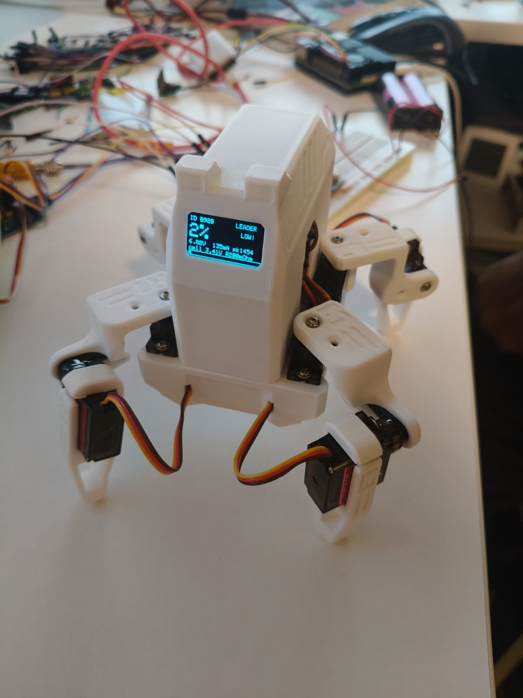
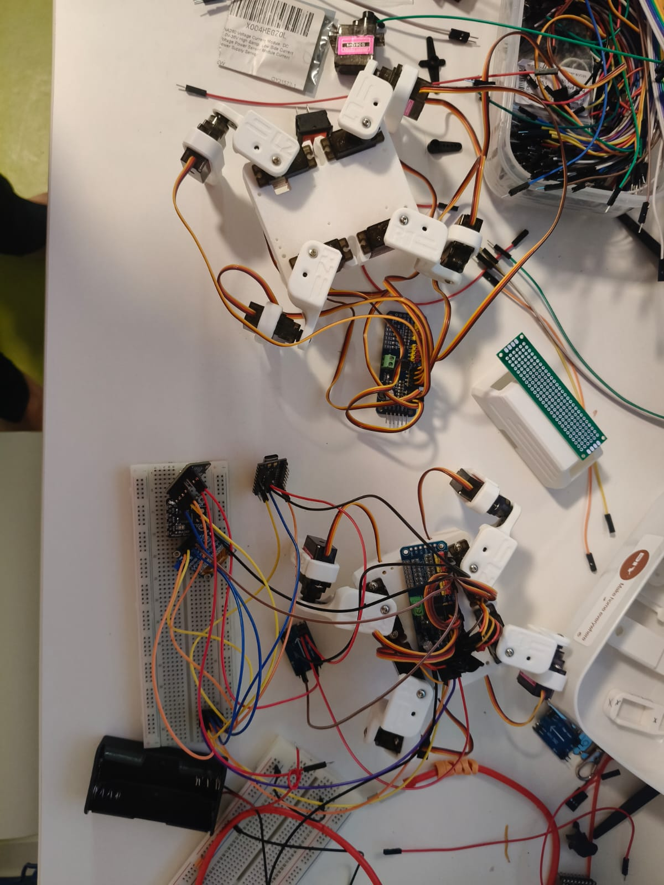
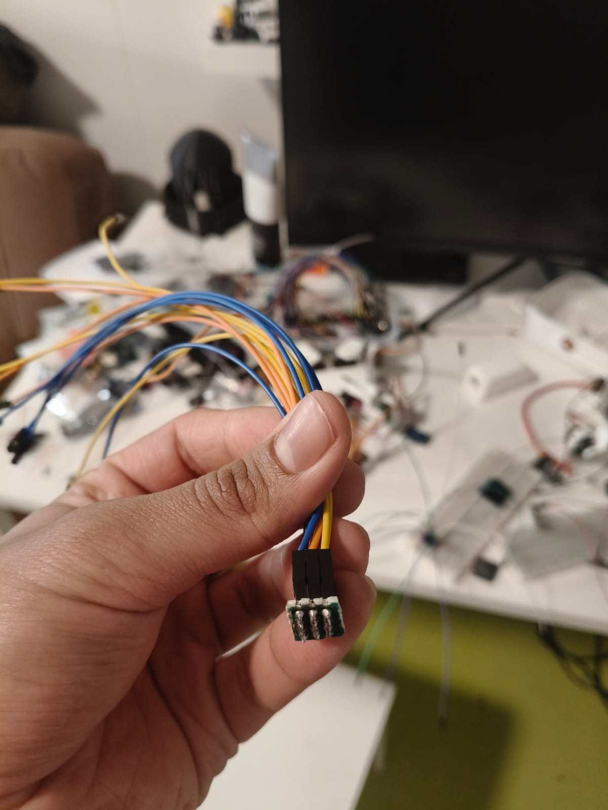
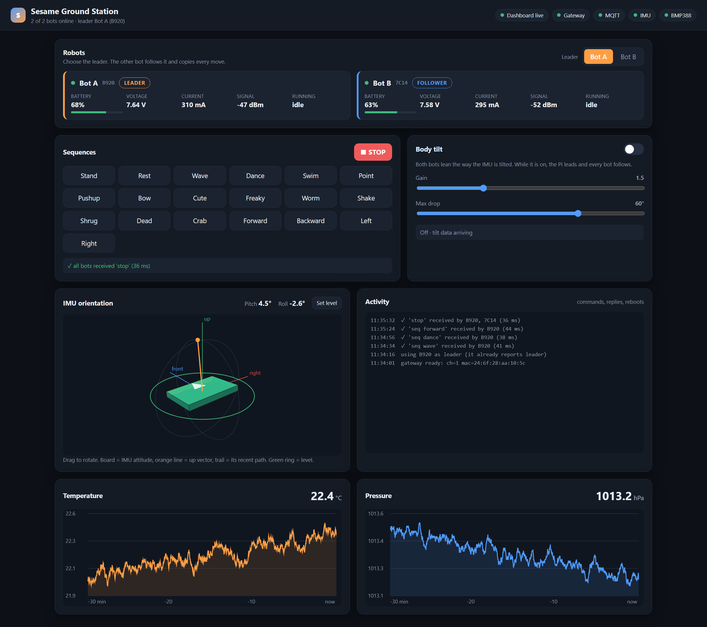

# Sesame Robots: Two Quadrupeds That Move Together


-blue?logo=c%2B%2B)


Two [Sesame](https://github.com/dorianborian/sesame-robot) quadruped robots that talk to each other over
**ESP-NOW** and are driven from a **Raspberry Pi ground station**. One robot is the leader and the other
follows it, so both perform the same sequence (wave, dance, walk...) together. A web dashboard on the Pi shows
each robot's battery, current and signal strength. An IMU on the Pi can tilt both bodies at once.

> [!IMPORTANT]
> **Built on the original Sesame Robot by [Dorian Todd](https://www.doriantodd.com/):
> [github.com/dorianborian/sesame-robot](https://github.com/dorianborian/sesame-robot).**
> The robot's mechanical design, CAD/STL files, PCBs, build and wiring guides, the original firmware, face
> bitmaps and movement sequences all come from that project. This repository is a fork that adds multi-robot
> control on top of it. Please star and support [the original repo](https://github.com/dorianborian/sesame-robot).
> Its documentation is kept [below](#the-original-sesame-robot).

<p align="center">
  
  
  
</p>

## How it works

```
 Raspberry Pi                                                       Robots (ESP32-S3 SuperMini + PCA9685)
 ┌────────────────────────────────────────────────┐   USB    ┌──────────────┐  ESP-NOW  ┌───────────────┐
 │ imu_publisher.py ──┐                           │  serial  │  ESP-NOW     │ ch 1      │ Bot A  leader │
 │ bmp388_publisher ──┴─► Mosquitto ─► app.py ────┼─────────►│  gateway     │◄─────────►│               │
 │                                      │         │          │  (WROOM-32)  │           │ Bot B follower│
 │                    dashboard :8000 ◄─┘         │          └──────────────┘           └───────────────┘
 └────────────────────────────────────────────────┘
```

- **Leader/follower in lockstep.** The leader announces each sequence over the radio. The follower plays the
  same sequence from its own memory, step for step, so a lost packet cannot make it skip a move.
- **Telemetry.** Each bot reports battery state (INA260), current, role and RSSI. The gateway passes these
  reports to the Pi, and the dashboard shows them.
- **Body tilt.** An MPU6500 on the Pi streams pitch/roll over MQTT, and both bots lean to match.
- **Reliable commands.** Each command is acknowledged and re-sent up to 3 times. The dashboard shows when a
  command is refused and why.

<p align="center"></p>

## Repository layout

| Path | What it is |
|---|---|
| [`firmware/espnow-sequence-tester-pca/`](firmware/espnow-sequence-tester-pca/) | **Robot firmware** for this fork. Flash the same sketch to both bots, then choose leader/follower |
| [`firmware/espnow-gateway/`](firmware/espnow-gateway/) | **Gateway firmware**: ESP-NOW ⇄ USB serial bridge for the Pi |
| [`ground-station/`](ground-station/README.md) | **Raspberry Pi** controller, MQTT sensor publishers, web dashboard |
| [`firmware/sesame-firmware-main/`](firmware/sesame-firmware-main/) | Original single-robot Wi-Fi firmware (web UI, JSON API) |
| [`firmware/debugging-firmware/`](firmware/debugging-firmware/) | Servo test sketch used during assembly |
| [`firmware/archive/`](firmware/archive/README.md) | Earlier bench testers kept for reference |
| [`hardware/`](hardware/README.md) | CAD, STLs, PCB files and bill of materials (upstream) |
| [`docs/`](docs/README.md) | Build, wiring and motor-testing guides, ESP32-S3 SuperMini notes, project write-up (PDF) |
| [`software/`](software/README.md) | Links to Sesame Studio and the Companion App (upstream) |

## Quick start (two-bot setup)

1. **Build two Sesame bodies.** Follow the [build guide](docs/build-guide/README.md) and the
   [motor-testing guide](docs/motor-testing/README.md).
2. **Wire each bot.** You need an ESP32-S3 SuperMini, a PCA9685 servo driver (channels 0-7), an SSD1306 OLED,
   and an INA260 at **0x41** (the PCA9685 uses 0x40). All of them share I²C on SDA 6 / SCL 11. See the
   [SuperMini notes](docs/esp32-s3-supermini/README.md).
3. **Flash the robots** with [`espnow-sequence-tester-pca`](firmware/espnow-sequence-tester-pca/).
   Arduino IDE settings: *ESP32S3 Dev Module*, *USB CDC On Boot: Enabled*.
   Libraries: Adafruit SSD1306 + Adafruit GFX.
4. **Flash the gateway** (any ESP32 dev board, *ESP32 Dev Module*) with
   [`espnow-gateway`](firmware/espnow-gateway/), and plug it into the Pi.
5. **Run the ground station** on the Pi. Follow [`ground-station/README.md`](ground-station/README.md),
   then open `http://<pi-ip>:8000`.

> [!TIP]
> If both bots skip moves in the middle of a routine, check the power supply before the code. See
> *Troubleshooting* in the [ground-station README](ground-station/README.md#troubleshooting).

## License and credits

This project is a fork of **[Sesame Robot](https://github.com/dorianborian/sesame-robot)** by
[Dorian Todd](https://www.doriantodd.com/), released under the Apache License 2.0. This fork uses the same
license, see [LICENSE](LICENSE).

**From the original Sesame Robot:** the robot design, CAD and STL files, Distro Board PCBs, bill of materials,
build, wiring and printing guides, `sesame-firmware-main`, the face bitmaps and the movement sequences that the
fork's firmware reuses.

**Added in this fork:** the ESP32-S3 SuperMini + PCA9685 port, ESP-NOW leader/follower firmware, the
ESP-NOW gateway, the Raspberry Pi ground station and dashboard, and the SuperMini porting notes.

Related upstream projects: [Sesame Studio](https://github.com/dorianborian/sesame-studio) and the
[Sesame Companion App](https://github.com/dorianborian/sesame-companion-app).

---

## The original Sesame Robot

> The section below is the README of the original project,
> [dorianborian/sesame-robot](https://github.com/dorianborian/sesame-robot), kept here so the build
> documentation stays with the files it describes. Join the Sesame community through the links below.


<p align="center">
  <a href="https://www.youtube.com/watch?v=NIgoQVQF_Ng">
    
  </a>
  <a href="https://discord.gg/XDXkhQd8bC">
    
  </a>
</p>

___

**Greetings, from your new best friend.**

Sesame is an accessible Open-Source robotics project based on the ESP32 microcontroller system, with an emphasis on expression and movement. 
This project is designed for makers and engineers of all skill levels! Sesame offers a dynamic platform designed to start working with walking robots. 
To build a sesame robot, you will need basic soldering skills, $50-60 in hardware components, access to a 3D printer, and a basic understanding of Arduino IDE.

This repository contains the CAD design files, STL files, build and wiring guides, and the base/expanded firmware for the ESP32-based controller. 
There is also some included debugging firmware that may be helpful in getting your Sesame up and running.

### Features

*   **Quadruped Design:** Uses 8 servo motors (2 per leg) to achieve roughly 8 total degrees of freedom.
*   **Emotive Display:** Features a 128x64 OLED screen acting as a reactive face that syncs with movement.
*   **Fully Printable:** Designed entirely for 3D printing in PLA with minimal supports.
*   **Network Connectivity:** Connect to your WiFi network for remote control and API access.
*   **JSON API:** RESTful API for programmatic control from Python, JavaScript, and more.
*   **Conversational Faces:** Expressive emotion library with talk variants for voice assistant projects.
*   **Sesame Studio:** New animation composer software to easily create custom movements.
*   **Sesame Companion App:** Python application for voice control and advanced interactions.
*   **Serial CLI:** Control the robot and trigger animations via a Serial Command Line Interface or the web UI.
*   **Pre-programmed Emotes:** Includes animations for Walking, Waving, Dancing, Pointing, Resting, and more.


### Watch the launch video on YouTube

<a href="https://www.youtube.com/watch?v=1UDsWkcQZhc"></a>

___

### Getting Started

Follow these steps to build your own Sesame Robot:

#### 1. Gather Parts
Check the **[Bill of Materials (BOM)](hardware/bom/README.md)** for a complete list of required electronics and hardware.
*   Microcontroller: Lolin S2 Mini (recommended for DIY builds), Sesame Distro Board V3 (Current, pre-flashed, supports Bambu Lab battery), V2 (legacy, USB-only), or ESP32-DevKitC-32E with Distro Board V1 (legacy)
*   Actuators: 8x 180 Degree MG90 Servos
*   Power: 5V 3A source (USB-C PD for S2 Mini and V2 Distro Board, or battery + buck converter; see BOM for the Bambu Lab 14500 7.4V 800mAh Li-ion Battery option)

#### 2. Print Parts
Download the STLs and follow the **[Printing Guide](hardware/printing/README.md)**.
*   Designed for PLA
*   Minimal supports required

#### 3. Build & Wire
Follow the **[Build Guide](docs/build-guide/README.md)** and **[Wiring Guide](docs/wiring-guide/README.md)** to assemble the frame and connect the electronics.

#### 4. Flash Firmware
Upload the code from the **[Firmware Directory](firmware/README.md)**.
*   Requires Arduino IDE
*   Configure WiFi AP settings

#### 5. Create Animations
Use **[Sesame Studio](https://github.com/dorianborian/sesame-studio)** to visually design poses and sequences for your robot.


---

### Software & Firmware

#### Sesame Studio
Sesame Studio is a desktop application for designing animations, sequencing poses, and creating OLED expressions. It is maintained in its own dedicated repository at [dorianborian/sesame-studio](https://github.com/dorianborian/sesame-studio). It allows you to:
*   Visually pose the robot in a 3D viewport using the actual printed STL geometry.
*   Sequence frames into complex animations with custom transitions and delays.
*   Design 128x64 OLED face bitmaps or directly open, edit, and save Arduino `face-bitmaps.h` files.
*   Generate C++ code for servo angles and bitmaps ready to paste into firmware.

[**> Go to Sesame Studio Repository**](https://github.com/dorianborian/sesame-studio)


#### Sesame Simulator
The Sesame Simulator, created by Jay Li, is a Rust-based 3D simulation environment for testing Sesame's movements and kinematics in a virtual space. It features:
*   **Physics-based Simulation:** Test walking and balance without hardware.
*   **Web-based Interface:** Run the simulator directly in your browser.
*   **URDF Integration:** Accurate modeling of Sesame's physical properties.

[**> Go to Sesame Simulator**](https://one-for-all.github.io/sesame-robot-sim/)

#### Sesame ML Tools
ML tools Created by Luke Hollis for Sesame, world model for online planning, policy eval, and RL finetuning.
*   **Robot description:** Self-contained printable STLs, CAD-derived MJCF, validated URDF, camera/IMU/foot frames, primitive contact geometry, masses and actuator limits
*   **Tasks:** Stand, challenged recovery, commanded locomotion, and goal/obstacle navigation
*   **Policy evaluation:** Multi-seed JSON/CSV reports, strict task success, domain parameters, tracking/fall/collision/energy/latency metrics, MP4/GIF and onboard/split views


[**> Go to Sesame ML Repo**](https://github.com/lukehollis/sesame-ml)

#### Sesame Companion App
The Sesame Companion App is a Python-based application that enables advanced control and interaction with your robot over your local network. It leverages the new JSON API and network mode features to provide:
*   **Voice Assistant Integration:** Control Sesame with voice commands and see real-time emotional expressions.
*   **Remote Control:** Command your robot from anywhere on your local network.
*   **Face Control:** Change expressions dynamically based on conversation or context.
*   **API Examples:** Reference implementation for building your own integrations.

The Companion App works with robots running the latest firmware with network mode enabled.

[**> Go to Sesame Companion App Repository**](https://github.com/dorianborian/sesame-companion-app)

#### Firmware
The ESP32 firmware (`sesame-firmware-main.ino`) handles the kinematics, face display, and WiFi control interface.
*   **Web UI:** Control the robot from your phone via the built-in Access Point.
*   **Custom Faces:** Add your own bitmaps (guide in firmware docs).

[**> Go to Firmware Docs**](firmware/README.md)


---

### Contributing

This robot is a platform for building new features, cosmetics, tools, and ideas. Since the current firmware is a basic implementation, pull requests are very welcome for:
*   Kinematics improvements
*   New animations
*   Improved Web UI/UX
*   Sensor integration (Ultrasonic, Gyro, etc.)

I would also love to see forks of this project with new hardware, software, faces, etc. Be sure to send me a message if you end up building one, and I might feature you on my website or channel!
  
---

*Created by [Dorian Todd](https://www.doriantodd.com/). Need help with your Sesame Robot? Send me a message on Discord, my username is "starphee"*
